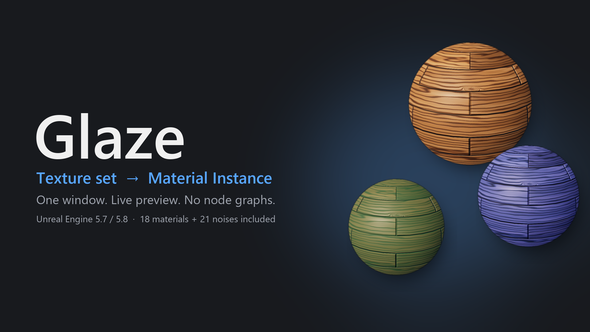
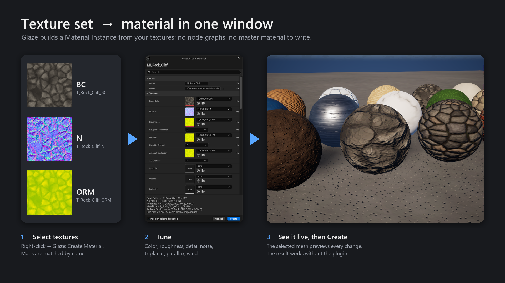
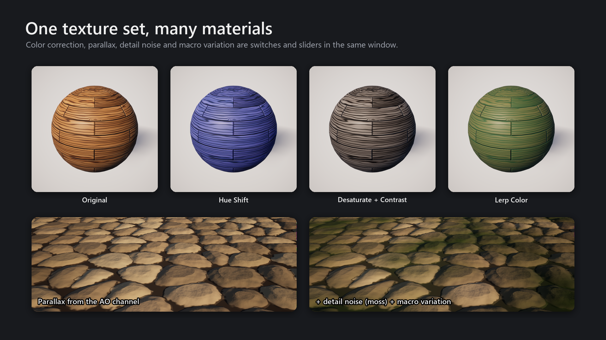
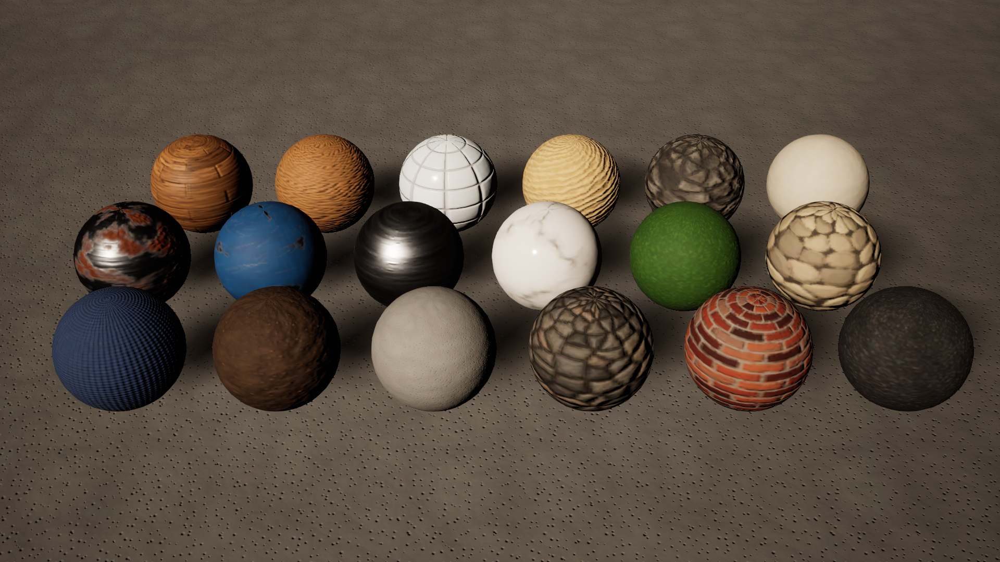

# Glaze — Texture Set to Material in One Window

Glaze is an editor plugin for **Unreal Engine 5.7 and 5.8** that turns a texture set into a finished
**Material Instance** without opening a material graph.

Select your textures in the Content Browser, right-click → **Glaze: Create Material**. Glaze matches the maps by
name, opens one window with every setting and previews each change live on the meshes selected in your level.
Press **Create** to get a regular Material Instance.

**Your materials do not depend on the plugin.** Glaze writes a standard master material (`/Game/Glaze/M_Glaze`) and
Material Instances into your project. Disable or remove the plugin and everything keeps working, in the editor and
in packaged games.

## How it works

1. Select a texture set (BaseColor / Normal / ORM / Roughness / Height…) in the Content Browser.
2. Right-click → **Glaze: Create Material**. The maps are sorted into slots by their names: Quixel, Poly Haven,
   ambientCG and Substance naming, packed ORM / ARM / RMA.
3. Tune the look in the Glaze window. The meshes selected in the level show the result immediately;
   **Cancel** restores their original materials.
4. **Create** → a Material Instance appears next to the textures.

## One texture set, many looks

## Features

- Automatic map matching by name, including packed channels, DirectX / OpenGL normals and gloss → roughness.
- Live preview on the selected meshes; Cancel restores their original materials.
- Batch: select several texture sets at once → **Create & Next** / **Create All**.
- **Edit with Glaze**: reopen any Glaze material with its settings (stored in the asset).
- Automatic texture settings fix (Normalmap / Masks compression, sRGB), undone on Cancel.
- Color correction: tint, desaturation, contrast, brightness, hue shift, overlay, lerp color.
- Roughness / Metallic / Specular / AO remap: invert, contrast, bias, min / max.
- UV tiling, offset and rotation (with correct normals), or World / Object triplanar projection.
- Parallax Occlusion Mapping from a Height map or a packed channel: depth and step count.
- Detail noise (procedural or texture) in World, Local or UV space, with color, roughness and bump.
- Macro variation to break up tiling on large surfaces.
- Opaque / Masked (with dithering) / Two Sided, emissive.
- Wind: vertex sway by height or by vertex color, with gusts.
- Works on static, skeletal, instanced and spline meshes, geometry caches and Niagara meshes.

## Included content

- **18 stylized PBR materials** (BaseColor / Normal / ORM, 2K and 1K, importable as 512 and 256):
  Content Browser → right-click → **Glaze: Material from Pack**.
- **21 tileable grayscale noises** with a noise window (preview, tiling, invert, levels, gamma, contrast):
  **Glaze: Noise from Pack**.
- Pack textures are imported into `/Game/Glaze/Pack` only when you ask for them.

All pack textures were made with **[PocketTextureLab](https://intpoln.github.io/PocketTextureLab/)**.

## Installation

**Fab:** get Glaze on Fab and install it to your engine from the Epic Games Launcher.

**Manual:** download `Glaze_5.7_source.zip` or `Glaze_5.8_source.zip` from
[Releases](https://github.com/intpoln/Glaze/releases/latest), unpack it into `<YourProject>/Plugins/` so that you get
`<YourProject>/Plugins/Glaze/Glaze.uplugin`, and open the project. It is a C++ project plugin: the editor compiles it
on first launch (a C++ toolchain is required; for a Blueprint-only project, add any C++ class first or install Glaze
from Fab).

## Technical details

- Editor-only plugin (one Editor module `GlazeEditor`), Win64. Unreal Engine 5.7 and 5.8.
- Nothing from Glaze is needed at runtime: the generated material is a regular project asset.

## Support

Questions and bug reports: [Issues](https://github.com/intpoln/Glaze/issues).
